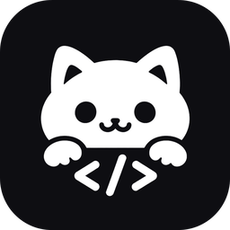

<div align="center">



# Cyexs Dock

**Windows için çentik ve dock.**

</div>

Cyexs Dock, [kua8/Nectar](https://github.com/kua8/Nectar) projesinin (v1.10.0) değiştirilmiş bir sürümüdür. Asıl tasarım ve kodun büyük kısmı Nectar'a aittir; bu depo yalnızca aşağıdaki değişiklikleri ekler. Lisans GPL-3.0'dır (bkz. [LICENSE](LICENSE)).

## Nectar'dan farkları

- **Ad ve simge:** uygulamanın adı Cyexs, simgesi kedi logosu.
- **Otomatik güncelleme kapalı:** program internetten kendini güncellemez. Yeni sürüm için kaynaktan yeniden derlenir.
- **Bildirimler çentikte:** Windows bildirimleri çentikte uygulama simgesiyle birlikte açılır. Fareyle üzerine gelince büyür, tıklayınca bildirimi gönderen uygulamayı açar.
- **Dock'ta sistem köşesi:** Wi-Fi, ses ve pil simgeleri ile gizli simgeler düğmesi dock'un sağında. Tıklayınca Wi-Fi/Bluetooth aç-kapa, parlaklık ve ses ayarları olan bir panel açılır.
- **Başlat düğmesine sağ tık:** Windows'un Win+X menüsündeki öğeler (Ayarlar, Görev Yöneticisi, Terminal, Kapat vb.) Cyexs görünümünde.
- **Düzeltmeler:** Wi-Fi/Bluetooth aç-kapa, uzun sağ tık menülerinin tıklanması ve tanıtım turunun her açılışta çıkması düzeltildi.

## Kurulum (kaynaktan derleme)

Hazır kurulum dosyası yok; program kaynaktan derlenir.

Gerekenler:

- [Rust](https://rustup.rs) (stable, MSVC)
- Visual Studio Build Tools, "C++ ile masaüstü geliştirme" bileşeni
- [Bun](https://bun.sh)
- WebView2 (Windows 11'de zaten var)

Derleme:

```bash
bun install --frozen-lockfile
bun run tauri build --no-bundle
```

Çıkan dosya: `src-tauri/target/release/cyexs.exe`. Klasör yolu çok uzunsa derleme `LNK1104` hatası verebilir; o zaman `CARGO_TARGET_DIR` ortam değişkenini kısa bir klasöre (örn. `C:\cyexs-build`) ayarlayın.

## Bilinmesi gerekenler

- **Antivirüs uyarısı:** program imzasız ve görev çubuğunu değiştirmek için klavye kancası, pencere yönetimi gibi Windows özelliklerini kullanıyor. Bazı antivirüsler (ör. Kaspersky) bu yüzden uyarı verebilir.
- **Başlat menüsü:** Windows görev çubuğu gizli olduğu için Başlat menüsü açılınca dock'un üstüne biner. Bu Windows'tan kaynaklanıyor.
- **Ayarların tamamı:** Nectar'ın tüm ayarları için [SETTINGS.md](SETTINGS.md).

## Teşekkür

Nectar'ı geliştiren [kua8](https://github.com/kua8)'e ve Nectar'ın dayandığı Bloom projesine.
